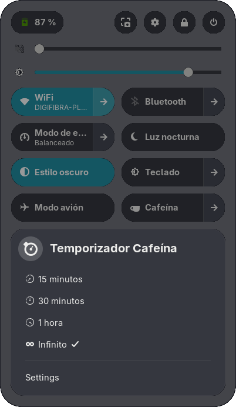
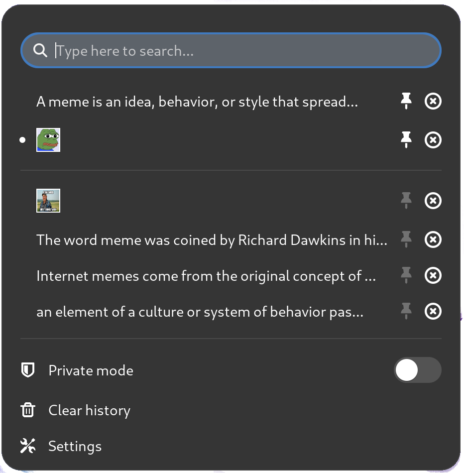
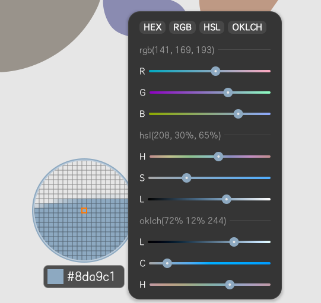
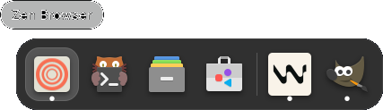

A lo largo de los años he ido saltando entre diferentes distribuciones de Linux y entornos de escritorio, pero en los últimos años he estado usando GNOME.
Lo que me gusta de GNOME es que es muy fácil de personalizar y que tiene muchas extensiones disponibles, así puedo hacer que se vea y funcione como yo quiero.

Ahora mismo estoy usando Fedora Workstation 42 con GNOME Shell 48.4, y esta combinación ha sido la más fluida que he tenido en mucho tiempo. Mis prioridades son estas:

- **Estabilidad**: Quiero tener un sistema estable y fiable que no dé problemas con ninguna actualización ni nuevas versiones del sistema. El gestor de paquetes RPM es un plus.
- **Productividad**: Quiero poder trabajar de forma eficiente. Como programador uso muchas herramientas y quiero tener una experiencia rápida y fluida.
- **Estética**: Quiero una interfaz visualmente atractiva y moderna. Me gusta un aspecto limpio y minimalista, pero también contar con muchas opciones de personalización.

## Extensiones de GNOME

GNOME funciona bien tal cual viene, pero para mí, las extensiones son donde ocurre la magia. Cada una resuelve un pequeño punto de fricción. Estas son mis favoritas ahora mismo:

### AppIndicator and KStatusNotifierItem Support

Esto recupera los "iconos de bandeja heredados" que GNOME oculta por defecto. Para mí es esencial para apps que permanecen abiertas todo el tiempo como Docker, Slack y Telegram.

[Enlace a la extensión](https://gitlab.com/ubuntu/gnome-shell-extension-appindicator)

### Caffeine

A veces necesito mantener mi portátil sin suspender durante mucho tiempo, como cuando entreno modelos de machine learning pesados, ejecuto tareas con grandes volúmenes de datos, o simplemente cuando no quiero que el portátil se suspenda. Caffeine resuelve esto con un solo click. Me gusta tener el indicador en la barra superior para poder acceder fácilmente.

Incluye una función de temporizador por si quieres definir un tiempo específico durante el que mantener el ordenador activo.

[Enlace a la extensión](https://github.com/eonpatapon/gnome-shell-extension-caffeine)

<!-- img-center img-xsmall img-no-shadow -->


### Clipboard Indicator

Paso el día pegando cosas: URLs, comandos, notas, etc., y muchas veces necesito volver a algo que copié hace 10 minutos. Clipboard Indicator mantiene un historial con búsqueda (lo configuro a 100 elementos, nunca se sabe cuándo se necesitarán 😉), ignora campos de contraseña por seguridad y se limpia automáticamente cuando alcanza un límite de tamaño.

[Enlace a la extensión](https://github.com/Tudmotu/gnome-shell-extension-clipboard-indicator)

<!-- img-center img-xsmall img-no-shadow -->


### Color Picker

Si haces diapositivas, maquetas documentos o cualquier trabajo de diseño/desarrollo, te va a encantar. Lo tengo en la barra superior para poder seleccionar un color de la pantalla y copiar al instante el código hexadecimal al portapapeles.

También guarda un historial de los colores que has copiado, para acceder a ellos fácilmente, y permite guardar colores en una lista de favoritos.

[Enlace a la extensión](https://github.com/tuberry/color-picker)

<!-- img-center img-small img-no-shadow -->


### Dash to Dock

El dash por defecto de GNOME está bien, pero Dash to Dock hace que cambiar entre apps sea más rápido e inteligente. Lo configuro con ocultamiento automático inteligente, iconos en 48 px y lo dejo en la parte inferior de la pantalla. También funciona bien con varios monitores, que es imprescindible para mí.

También puedo acceder a los programas del dock usando atajos de teclado. Por ejemplo, Super + Ctrl + 1 para acceder al primer programa, Super + Ctrl + 2 para el segundo, etc. Puedes configurar los atajos en la configuración de la extensión.

[Enlace a la extensión](https://github.com/micheleg/dash-to-dock)

<!-- img-center img-small img-no-shadow -->


### Just Perfection

Esta es para pulir los detalles. Te da opciones para modificar casi cualquier elemento de la interfaz en GNOME. Desactivo el reloj mundial, reduzco animaciones, especifico un formato de fecha en la barra superior y muchos otros ajustes. Son cambios pequeños que traen menos distracciones y una experiencia más fluida (y por qué no, elegante 🎩).

[Enlace a la extensión](https://gitlab.gnome.org/jrahmatzadeh/just-perfection)

### Space Bar

Los espacios de trabajo (workspaces) de GNOME son potentes, pero pueden sentirse invisibles si no estás acostumbrado a usarlos. Space Bar soluciona eso mostrándome mis espacios, a los que puedo cambiar con un solo click, de un vistazo. Funciona de maravilla con los atajos de teclado para navegar entre espacios.

[Enlace a la extensión](https://github.com/christopher-l/space-bar/)

### Tactile

Me gustan los entornos de escritorio de tipo mosaico o _tiling_, pero no quiero un gestor de ventanas completamente en mosaico. Tactile es el punto medio: ofrece ajuste a bordes, huecos configurables y atajos que encajan con mi memoria muscular. Las ventanas encajan en su lugar, los diálogos se mantienen flotando en el centro y nada se siente forzado.

[Enlace a la extensión](https://gitlab.com/lundal/tactile)

### User Themes

Esta es puramente estética: te permite poner el mismo tema para la Shell de GNOME que para tus apps GTK. El resultado es una apariencia coherente entre las apps y el escritorio. Solo me aseguro de que el tema mantenga un contraste fuerte para la legibilidad, ya que algunos no se integran bien con el escritorio o algunos programas.

Hay muchos temas disponibles en el [sitio GNOME Look](https://www.gnome-look.org/browse/)

[Enlace a la extensión](https://gitlab.gnome.org/GNOME/gnome-shell-extensions)

## Mis 3 extensiones esenciales

Después de probar muchas extensiones, estas son las que considero más útiles:

1. [Clipboard Indicator](https://github.com/Tudmotu/gnome-shell-extension-clipboard-indicator). Me ahorra mucho tiempo cuando necesito copiar algo y no quiero volver a buscarlo.
2. [Caffeine](https://github.com/eonpatapon/gnome-shell-extension-caffeine). Es imprescindible cuando necesito mantener el portátil sin apagar la pantalla durante mucho tiempo.
3. [Dash to Dock](https://micheleg.github.io/dash-to-dock/). Es el cambio más notable en el escritorio y estoy muy acostumbrado a usarlo en la parte inferior de la pantalla en lugar del dash por defecto de GNOME.

Estas son las que me resultan más útiles, pero hay muchas más extensiones disponibles en el [sitio de GNOME Extensions](https://extensions.gnome.org/).

## Cómo instalar extensiones

Para habilitar el uso de extensiones, necesitas instalar los paquetes `gnome-tweaks` y `gnome-browser-connector` (reemplazó el antiguo nombre `chrome-gnome-shell` en otras distros). Puedes instalarlos con este comando:

```bash
sudo dnf install gnome-tweaks gnome-browser-connector
```

Puedes instalar extensiones desde el [sitio de GNOME Extensions](https://extensions.gnome.org/) y gestionarlas localmente con la app GNOME Extensions.

```bash
sudo dnf install gnome-extensions-app
```

Para profundizar en cómo usar e instalar extensiones en Fedora, puedes consultar la [documentación oficial](https://docs.fedoraproject.org/en-US/quick-docs/gnome-shell-extensions/).